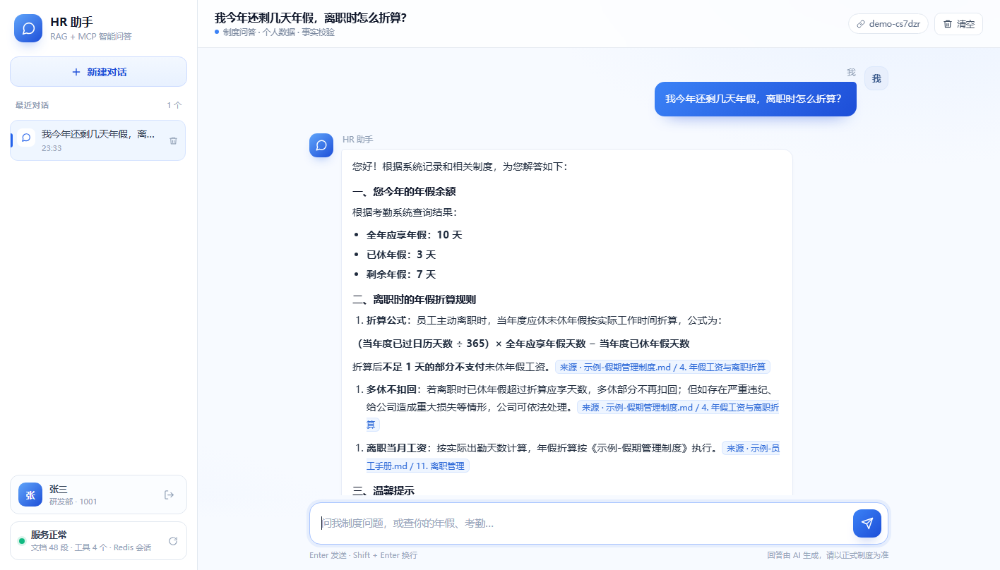
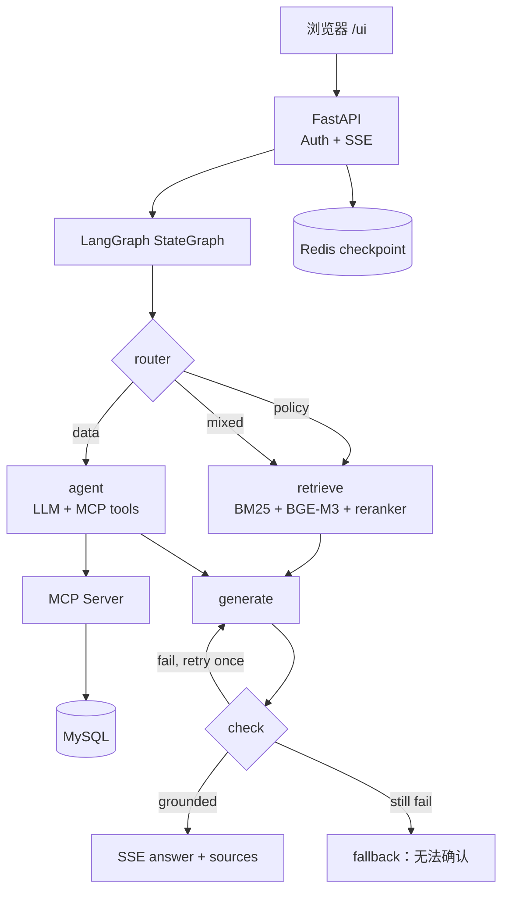

# HR 知识库智能问答 Agent

**RAG 知识库 + MCP 数据工具 + LangGraph 状态机 + FastAPI SSE 流式输出。**

一个面向员工的 HR 智能问答示例：既能回答公司制度，也能查询个人假期、考勤和部门信息；回答附带引用，并经过事实校验。

[](https://www.python.org/)
[](https://fastapi.tiangolo.com/)
[](https://langchain-ai.github.io/langgraph/)
[](https://modelcontextprotocol.io/)

[](https://ting54zhen.github.io/hr-agent/)

> 演示主页：<https://ting54zhen.github.io/hr-agent/>  
> `data/docs/` 中的文档和账号均为虚构演示数据，不是真实公司制度。

## 功能

- **制度问答**：BM25 + BGE-M3 向量混合召回，RRF 融合后由 bge-reranker 精排，取 Top-5 作为上下文。
- **个人数据**：通过独立 MCP Server 查询 MySQL 中的假期余额、考勤、员工资料和组织信息。
- **混合问题**：同时走 RAG 和 MCP，再统一生成回答。
- **引用来源**：回答中的 `[来源: 文件名 / 标题]` 可展开查看原文片段和重排分数。
- **事实校验**：生成后由 check 节点判断是否 grounded；不通过重试一次，仍失败则明确兜底，不编造。
- **多轮会话**：Redis checkpoint 按 `session_id` 保存上下文，支持「那病假呢」这类追问。
- **登录鉴权**：MySQL `users` 表 + PBKDF2 密码哈希，登录签发 HMAC Token，`/chat` 强制鉴权。
- **流式体验**：SSE 逐字输出，支持停止生成、失败重试、引用展开和移动端布局。

## 架构



| 层 | 技术 |
|---|---|
| API | FastAPI、Uvicorn、SSE |
| Agent | LangGraph StateGraph、结构化输出 |
| RAG | Chroma、BM25、BGE-M3、bge-reranker-v2-m3 |
| 工具 | MCP / FastMCP，只读 MySQL 工具 |
| 存储 | MySQL 8.4、Redis 8 |
| 前端 | 原生 HTML / CSS / JavaScript，无构建步骤 |
| 鉴权 | PBKDF2-SHA256 密码哈希 + HMAC Token |

## 快速开始

### 环境要求

- Python 3.12
- [uv](https://docs.astral.sh/uv/)
- Docker / Docker Compose
- 一个 OpenAI 兼容的 LLM API Key（DeepSeek、Qwen、智谱等均可）
- 约 5GB 空闲磁盘存放 BGE 模型；建议 8GB 以上内存

### 1. 获取代码并安装依赖

```bash
git clone https://github.com/Ting54zhen/hr-agent.git
cd hr-agent

# Windows 使用: copy .env.example .env
cp .env.example .env

uv sync
```

如果不需要 CUDA，Linux 上可替换为 CPU 版 PyTorch：

```bash
uv pip install --force-reinstall torch --index-url https://download.pytorch.org/whl/cpu
```

### 2. 启动 MySQL / Redis

```bash
docker compose up -d
docker compose ps
```

首次启动会自动执行 `scripts/seed_db.sql`，创建员工、假期、考勤和 `users` 表。

### 3. 配置 `.env`

```dotenv
LLM_PROVIDER=openai
LLM_MODEL=deepseek-chat
OPENAI_API_KEY=sk-your-key
OPENAI_BASE_URL=https://api.deepseek.com/v1

MYSQL_HOST=127.0.0.1
MYSQL_PORT=3306
MYSQL_USER=hr
MYSQL_PASSWORD=hr
MYSQL_DATABASE=hr

REDIS_URL=redis://localhost:6379/0
CHROMA_DIR=data/chroma

EMBED_MODEL=./models/bge-m3
RERANK_MODEL=./models/bge-reranker-v2-m3
HF_HOME=./models/.cache

HR_ALLOWED_IDS=1001,1002,1003
HR_AUTH_SECRET=please-change-to-a-long-random-string
HR_AUTH_TOKEN_TTL_HOURS=12
```

`.env` 已被 `.gitignore` 忽略，不要提交。

### 4. 下载本地模型

约 4.5GB。国内网络推荐使用 ModelScope：

```bash
uvx --from modelscope modelscope download --model BAAI/bge-m3 --local_dir ./models/bge-m3
uvx --from modelscope modelscope download --model BAAI/bge-reranker-v2-m3 --local_dir ./models/bge-reranker-v2-m3
```

也可以使用 HuggingFace：

```bash
uvx --from huggingface_hub huggingface-cli download BAAI/bge-m3 --local-dir ./models/bge-m3
uvx --from huggingface_hub huggingface-cli download BAAI/bge-reranker-v2-m3 --local-dir ./models/bge-reranker-v2-m3
```

### 5. 文档入库

```bash
uv run python -m app.rag.ingest
```

输出：

- `data/chunks.jsonl`：切分后的片段，BM25 使用
- `data/chroma/`：Chroma 持久化向量库

重新入库会清空旧集合；保留旧数据使用 `--no-reset`。

### 6. 启动服务

```bash
uv run python -m app.main
```

首次启动需要加载 BGE 模型，通常等待 15–30 秒。

打开 <http://127.0.0.1:8000/ui/>，使用演示账号登录：

| 工号 | 姓名 | 初始密码 |
|---|---|---|
| 1001 | 张三（研发部） | `123456` |
| 1002 | 李四（产品部） | `123456` |
| 1003 | 王五（HR 部） | `123456` |

也可以直接打开 <http://127.0.0.1:8000/docs> 调试接口。

### 7. 健康检查

```bash
curl http://127.0.0.1:8000/health
```

正常返回示例：

```json
{
  "status": "ok",
  "llm_configured": true,
  "graph_ready": true,
  "checkpointer": "redis",
  "chunks": 48,
  "tools": ["get_leave_balance", "get_attendance", "get_employee_profile", "get_org_info"],
  "startup_error": null
}
```

## 账号与密码

账号密码存放在 MySQL `users` 表，密码使用 **PBKDF2-SHA256（600,000 次迭代，每个账号独立随机盐）** 哈希，不保存明文。

| 字段 | 说明 |
|---|---|
| `employee_id` | 主键，关联 `employees.id` |
| `password_hash` | `pbkdf2_sha256$迭代次数$盐$哈希` |
| `is_active` | 0 表示禁止登录 |
| `created_at` | 创建时间 |
| `last_login_at` | 最近登录时间 |

首次建库由 `scripts/seed_db.sql` 写入。已有数据库可以执行：

```bash
uv run python scripts/seed_users.py

# 重置指定账号密码
uv run python scripts/seed_users.py --ids 1001 --password 新密码 --reset
```

新增员工需要同时写入 `employees`、`users`，并加入 `HR_ALLOWED_IDS`（MCP 的二次白名单）。将 `users.is_active` 置为 0 可禁止登录。

## 接口

### `POST /auth/login`

```bash
curl -X POST http://127.0.0.1:8000/auth/login \
  -H "Content-Type: application/json" \
  -d '{"employee_id":1001,"password":"123456"}'
```

返回 `access_token`、`token_type`、`expires_in` 和 `user`。之后访问 `/chat` 需要携带：

```text
Authorization: Bearer <access_token>
```

`GET /auth/me` 用于校验登录态。Token 是 HMAC 签名实现，密钥由 `HR_AUTH_SECRET` 控制；生产环境建议改用 argon2/bcrypt、增加登录限流，并通过 HTTPS 传输。

### `POST /chat`（SSE，需要登录）

```bash
curl -N -X POST http://127.0.0.1:8000/chat \
  -H "Content-Type: application/json" \
  -H "Authorization: Bearer <access_token>" \
  -d '{"message":"我还有几天年假？","session_id":"demo-1"}'
```

事件序列：

```text
event: meta      {"session_id":"demo-1","employee_id":1001}
event: token     {"text":"你"}
event: token     {"text":"目前"}
...
event: done      {"answer":"...","route":"data","grounded":true,"sources":[...]}
```

- `token` 用于前端逐字渲染。
- 事实校验失败并重试时，会先收到 `event: reset`，前端应清空当前回答。
- `done` 带完整 `answer`，可作为兜底覆盖。

### `POST /search`（只测检索，不调用 LLM）

```bash
curl -X POST http://127.0.0.1:8000/search \
  -H "Content-Type: application/json" \
  -d '{"query":"年假没休完可以结转吗","top_k":5}'
```

没有 LLM Key 时也可以用它验证 RAG 召回。

### 演示问题

| 类型 | 问题 | 预期 |
|---|---|---|
| policy | 年假没休完可以结转到什么时候？ | 引用《示例-假期管理制度》 |
| policy | 迟到 30 分钟以内怎么处理？ | 引用《示例-考勤与远程办公制度》 |
| data | 我还有几天年假？ | 调 `get_leave_balance`，返回 7 天 |
| data | 我上个月迟到几次？ | 调 `get_attendance`，返回 2026-10 有 1 次迟到 |
| mixed | 我今年还剩几天年假，离职时怎么折算？ | 先查余额，再引用折算规则 |
| 无答案 | 公司食堂几点开饭？ | 明确说资料中无法确认 |

## RAG 细节

1. **解析**：PDF 用 PyMuPDF，DOCX 用 python-docx（保留 Heading 层级），Markdown/TXT 直接读取。
2. **切分**：先按 Markdown 标题切 section，再用 `RecursiveCharacterTextSplitter` 切 500 token、overlap 80。
3. **向量化**：`BAAI/bge-m3`，CPU，`normalize_embeddings=True`，写入 Chroma。
4. **召回**：dense Top-20 + BM25 Top-20。
5. **融合**：RRF（k=60）。
6. **重排**：`BAAI/bge-reranker-v2-m3`，取 Top-5。
7. **引用**：Prompt 要求标注 `[来源: 文件名 / 标题]`。
8. **兜底**：资料不足时明确说无法确认，不猜测。

调参位置：`app/rag/ingest.py` 的 `chunk_size` / `chunk_overlap`，`app/rag/retriever.py` 的 `RRF_K` / Confidence 阈值，以及 `.env`：

```dotenv
# 进入 reranker 的候选数；CPU 上重排是主要耗时
RETRIEVAL_RECALL_K=10
RERANK_MAX_LENGTH=512
RERANK_BATCH_SIZE=8
```

CPU 实测：20 个候选单次检索约 17–22 秒，10 个候选约 6–11 秒，两者 Recall@5 / MRR 相同。

## MCP 设计

`app/mcp_server/server.py` 暴露四个只读工具：

| 工具 | 作用 | 关键点 |
|---|---|---|
| `get_leave_balance` | 年假/病假余额 | 只读、按工号白名单 |
| `get_attendance` | 月度考勤明细与汇总 | 校验 `YYYY-MM` |
| `get_employee_profile` | 按工号查部门、邮箱、直属上级 | 「我的部门/上级」走这个工具 |
| `get_org_info` | 按姓名查组织信息 | 查到人后再校验可见性 |

安全措施：

- **只读**：不提供任意 SQL 工具，避免 Prompt 注入后执行写操作。
- **服务端鉴权**：`HR_ALLOWED_IDS` 在 MCP Server 内校验，不信任模型传入的工号。
- **行级权限**：`get_employee_profile` 先校验工号白名单；`get_org_info` 查到人后再次过滤允许的工号。
- **审计**：每次调用写入 `logs/mcp_audit.jsonl`，包含时间、工具、工号、参数、成功/失败。
- **错误脱敏**：不把 SQL 异常和数据库结构返回给模型。

登录态由 FastAPI 的 HMAC Token 提供，`/chat` 不再信任请求体传入的 `employee_id`。

## LangGraph 状态

`app/agent/graph.py` 的 `AgentState`：

```python
messages      # add_messages 累积多轮消息
employee_id   # 当前登录员工
route         # policy / data / mixed / chitchat
context       # 检索到的资料
sources       # 引用来源
retry_count   # 事实校验重试次数
grounded      # 是否通过校验
check_reason  # 校验理由
```

关键边：

```text
router ──policy──> retrieve ──> generate ──> check ──pass──> END
   │                                  ▲          │
   ├──data──> agent ──tool_calls──> tools        │fail（最多 1 次）
   │            └────no tool────> generate ──────┘
   └──mixed─> retrieve ──> agent ──> generate ──> check
```

## 评测

`eval/qa.jsonl` 包含 50 条问题，覆盖 policy / data / mixed / 无答案。

只测检索（不需要 LLM Key）：

```bash
uv run python eval/run_eval.py
```

CPU 实测（35 条 policy 类问题，48 个 chunk）：**Recall@5 = 100%，MRR = 0.9714**。

需要保存结果时：

```bash
uv run python eval/run_eval.py --output result.json
```

## 目录

```text
hr-agent/
├─ app/
│  ├─ main.py                 FastAPI + SSE + 生命周期
│  ├─ auth.py                 users 表校验 + PBKDF2 + HMAC Token
│  ├─ config.py               .env 配置
│  ├─ rag/
│  │  ├─ ingest.py            解析 → 标题切分 → chunk → BGE-M3 → Chroma
│  │  └─ retriever.py         BM25 + 向量 + RRF + reranker
│  ├─ mcp_server/
│  │  ├─ server.py            FastMCP：四个只读工具
│  │  └─ db.py                MySQL 连接
│  └─ agent/
│     ├─ graph.py             LangGraph 状态机
│     ├─ prompts.py           路由 / 生成 / 校验 Prompt
│     └─ tools.py             langchain-mcp-adapters 加载 MCP 工具
├─ data/docs/                 示例 HR 文档
├─ scripts/
│  ├─ seed_db.sql             建表 + 示例数据（含 users 表）
│  ├─ seed_users.py           创建 users 表 / 重置账号密码
│  ├─ download_models_modelscope.py  ModelScope 下载脚本
│  ├─ download_models.py      HuggingFace 下载脚本
│  ├─ check_env.py            环境自检
│  ├─ smoke_test.py           MCP + RAG 冒烟测试
│  ├─ chat_cli.py             命令行测 /chat
│  └─ search_cli.py           命令行测 /search
├─ web/index.html             浏览器聊天页（/ui/）
├─ docs/index.html            GitHub Pages 演示主页
├─ eval/                      检索评测集与脚本
├─ docker-compose.yml         MySQL 8.4 + Redis 8
└─ .env.example
```

## 部署提示

- 需要常驻 Python 进程，不能直接部署到 Vercel / Netlify 这类纯静态平台。
- 同时加载 BGE-M3 + reranker，建议 4C8G 以上；想用 2C4G 可以换 `bge-small-zh-v1.5` + `bge-reranker-base` 并重新入库。
- 反向代理需要关闭缓冲，保证 SSE 逐字输出。Caddy 示例：

```caddyfile
hr-demo.example.com {
  encode zstd gzip
  reverse_proxy 127.0.0.1:8000 {
    flush_interval -1
  }
}
```

- 公网部署请修改 `HR_AUTH_SECRET`、数据库密码和演示密码，只放虚构数据。
- 不要暴露 3306 / 6379 / 8000；登录、`/chat` 和 `/search` 建议加限流，LLM Key 设置消费上限。

## 常见问题

### 模型下载慢或 401

优先使用 ModelScope；HuggingFace 镜像可设置：

```dotenv
HF_ENDPOINT=https://hf-mirror.com
HF_HUB_DISABLE_XET=1
```

### `/chat` 返回 503

查看 `/health` 的 `startup_error`：

- `graph: LLM 未配置`：`.env` 没有填 Key，或仍是占位符。
- `mcp: ...`：MCP Server 启动失败，检查 MySQL 和 `HR_ALLOWED_IDS`。
- `retriever: ...`：模型没下载完整，或 Chroma 目录损坏。

### 登录返回 503

检查 MySQL 是否启动，以及 `users` 表是否已创建：

```bash
docker compose ps
uv run python scripts/seed_users.py
```

### MySQL 中文乱码

首次导入时使用 UTF-8 客户端：

```bash
docker exec -i hr-mysql mysql -uroot -proot --default-character-set=utf8mb4 < scripts/seed_db.sql
```

### Token 失效

默认 12 小时过期，重新登录即可；可通过 `HR_AUTH_TOKEN_TTL_HOURS` 调整。

## 设计取舍

- **为什么 RAG 要 hybrid**：BM25 对制度编号、专有名词更稳，向量对同义表达更好；RRF 不需要调分数尺度。
- **为什么要 reranker**：召回阶段追求高 recall，rerank 阶段用 cross-encoder 提升 precision。
- **MCP 和 function calling 的区别**：MCP 是协议/进程边界，工具由独立 Server 提供，可复用、可审计；function calling 是模型输出工具调用的机制。
- **为什么要事实校验**：RAG 仍可能把检索到的相邻条款拼接错；check 节点用结构化输出判断 grounded，不通过重试或兜底。
- **权限为什么放服务端**：模型可能被 Prompt 注入诱导查询他人数据，白名单必须在 MCP Server 内执行。
- **Redis checkpoint 的作用**：按 `thread_id` 保存多轮消息，服务重启后会话可恢复；也方便做人工审批中断。

## 说明

示例项目，仅用于学习与作品展示。`data/docs/`、员工姓名、假期和考勤数据均为虚构，使用前请替换为你自己的文档、账号体系和密钥。
